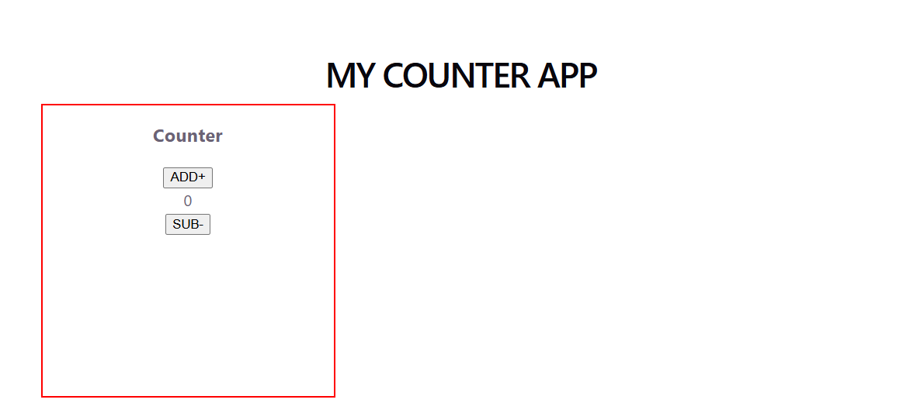
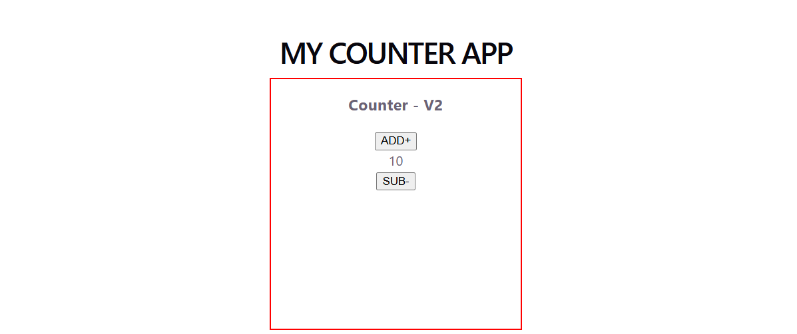
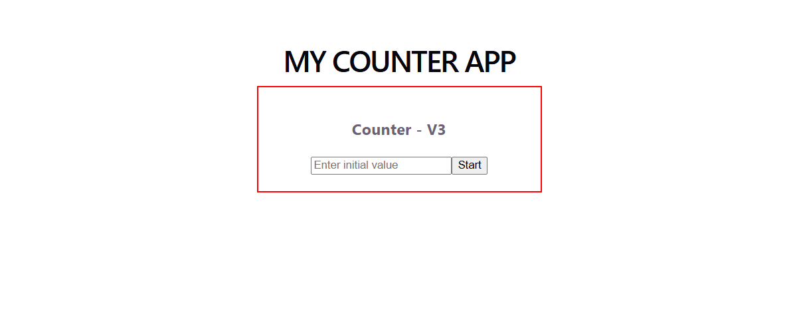

# React Counter App
 I made this project while learning React. I wanted to understand how state works in React, so I started with a simple counter and improved it step by step.

This project has three versions of the same counter app. Each version adds a small change that helped me understand React a little better.

## 🚀 Project Versions

### V1 — Basic Counter

The counter starts from `0`. Users can increase or decrease the value using the ADD+ and SUB- buttons.

**Screenshot:**



### V2 — Counter with Default Value

In this version, I changed the initial counter value from `0` to `10`. The increment and decrement buttons work the same way as in V1.

**Screenshot:**

<!-- Paste your V2 screenshot link below -->



### V3 — User Input Counter

In the third version, the user can enter their own starting value. After clicking the Start button, the counter begins from that value and can be increased or decreased.

**Screenshot:**

<!-- Paste your V3 screenshot link below -->



## 📁 Project Structure

I kept all three versions in separate folders so that the changes are easy to understand.

```text
React-Counter-App/
│
├── v1-basic-counter/
│   └── src/
│       ├── components/
│       │   └── CounterApp.jsx
│       ├── App.jsx
│       └── main.jsx
│
├── v2-custom-default/
│   └── src/
│       ├── components/
│       │   └── CounterApp.jsx
│       ├── App.jsx
│       └── main.jsx
│
├── v3-user-input/
│   └── src/
│       ├── components/
│       │   └── CounterApp.jsx
│       ├── App.jsx
│       └── main.jsx
│
└── README.md
```

*Note: This shows the main source files. Each version also contains its own configuration files and other project files.*

## 🛠️ Technologies Used

- React
- JavaScript
- HTML
- CSS
- Vite

## 📚 What I Learned

While building this project, I practised:

- Creating functional components in React
- Using the `useState` Hook to manage state
- Handling button clicks with `onClick`
- Taking input from users using `onChange`
- Updating the UI when state changes
- Organizing a project into reusable components

## ▶️ How to Run

Choose the version you want to try and open its folder in the terminal.

```bash
npm install
npm run dev
```

Vite will provide a local URL where you can open the app in your browser.

## 💡 Final Note

This is a small project, but building it in three stages helped me understand the basics instead of just copying a single implementation.
